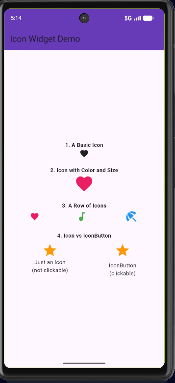

# Icon Widget Demo

A Flutter `Icon` is a small graphical symbol (like a heart, star, or umbrella) drawn from a font, used to visually represent something on screen.

## How to Run

1. Make sure you have  installed.
2. Clone or open this repo in VS Code.
3. Open a terminal in the project folder and run:
   ```bash
   flutter pub get
   flutter run
   ```


## Key Attributes Used

| Attribute | What it does |
|---|---|
| `icon` | Sets which icon to display (e.g. `Icons.favorite`) |
| `size` | Controls how big the icon appears, in logical pixels |
| `color` | Sets the color the icon is drawn in |


